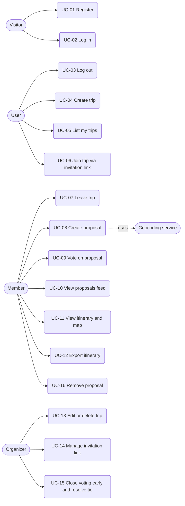
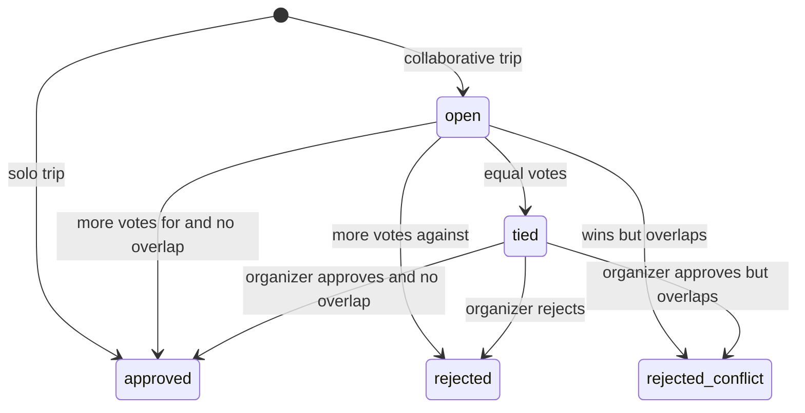

# MapMates: Use Cases

## 1. Actors

| Actor | Description |
| --- | --- |
| Visitor | Not authenticated user. |
| User | Authenticated user. |
| Member | A user participating in a trip (role per trip). |
| Organizer | A member who owns the trip (role per trip). Inherits all member use cases. |
| Geocoding service | External system (Nominatim) that resolves place searches. |

## 2. Use case diagram

## 3. Traceability: use cases and requirements

| Use case | Related requirements |
| --- | --- |
| UC-01 Register | FR-01, NFR-01, NFR-02 |
| UC-02 Log in | FR-02, NFR-01, NFR-04 |
| UC-03 Log out | FR-02 |
| UC-04 Create trip | FR-03, FR-13 |
| UC-05 List my trips | FR-04 |
| UC-06 Join trip via invitation link | FR-07, FR-08, BR-07, BR-08 |
| UC-07 Leave trip | FR-07 |
| UC-08 Create proposal | FR-09, FR-13, FR-23, BR-06, BR-09, BR-10, NFR-06 |
| UC-09 Vote on proposal | FR-10, BR-02, BR-03 |
| UC-10 View proposals feed | FR-16 |
| UC-11 View itinerary and map | FR-14, FR-17, FR-18 |
| UC-12 Export itinerary | FR-20, FR-21 |
| UC-13 Edit or delete trip | FR-05, FR-15 |
| UC-14 Manage invitation link | FR-06, BR-07 |
| UC-15 Close voting early and resolve tie | FR-11, FR-12, FR-14, BR-04, BR-11 |
| UC-16 Remove proposal | FR-19 |

## 4. Detailed use cases

### UC-06: Join trip via invitation link

| Field | Description |
| --- | --- |
| Actor | User |
| Preconditions | The trip is collaborative and has an active invitation link. |
| Trigger | The user opens an invitation link. |
| Main flow | 1. The system verifies the user is authenticated. 2. The system finds the invitation by its token. 3. The system verifies the link is not expired or revoked. 4. The system verifies the user is not already a member. 5. The system verifies the trip has not reached its maximum number of members. 6. The system adds the user to the trip with the role `member`. 7. The system redirects the user to the trip. |
| Alternative flows | A1. The user is already a member (step 4): no change is made and the user is redirected to the trip. A2. The user is not authenticated (step 1): the system sends the user to log in or register and, afterwards, returns to the invitation link. |
| Exceptions | E1. Token not found, expired or revoked: 404 (same response for all three, to avoid revealing information). E2. Trip is full: 409. E3. Malformed token: 400. |
| Postconditions | The user is a member of the trip with the role `member`. The trip's member count increased by one. |
| Related | FR-07, FR-08, BR-07, BR-08 |

### UC-08: Create proposal

| Field | Description |
| --- | --- |
| Actor | Member |
| Preconditions | The user is authenticated and is a member of the trip. |
| Trigger | The member submits the form to create a new activity proposal. |
| Main flow | 1. The member searches for a place using the external geocoding service (Nominatim). 2. The member selects the place and fills in category, proposed day, start time, end time, voting duration and an optional note. 3. The system validates that the proposed day falls within the trip's date range (BR-06). 4. The system validates that the end time is later than the start time and falls on the same day (BR-09). 5. The system verifies the time interval does not overlap any approved activity (FR-23, BR-10). 6. The system creates the proposal with status `open` and records its voting deadline. |
| Alternative flows | A1. Solo trip (FR-13): steps 1 to 5 apply unchanged, including the overlap check. In step 6 the proposal is created directly as `approved`, without voting, and appears in the itinerary. |
| Exceptions | E1. Not authenticated: 401. E2. User is not a member of the trip: 403. E3. Trip not found: 404. E4. Missing or invalid data (day outside the trip's range, end time not later than start time, note too long, voting duration out of range): 400. E5. Time interval overlaps an approved activity: 409. E6. Geocoding service unavailable: 502; rate limit exceeded: 429 (NFR-06). |
| Postconditions | A new proposal is created in the trip. If collaborative, voting is open; if solo, it is added to the itinerary. |
| Related | FR-09, FR-13, FR-23, BR-06, BR-09, BR-10, NFR-06 |

### UC-09: Vote on proposal

| Field | Description |
| --- | --- |
| Actor | Member |
| Preconditions | The user is authenticated and is a member of the trip. |
| Trigger | The member selects "for" or "against" on a proposal. |
| Main flow | 1. The system finds the proposal. 2. The system checks the user is a member of the trip. 3. The system checks the proposal is `open` and its voting deadline has not passed (BR-03). 4. The system records the vote (or replaces the previous one). 5. The system updates and shows the vote count. |
| Alternative flows | A1. The user already voted the same option: the vote is withdrawn. |
| Exceptions | E1. Not authenticated: 401. E2. Not a member of the trip: 403. E3. Voting is not open (status other than `open`, or deadline passed): 409. E4. Proposal not found: 404. |
| Postconditions | At most one vote per user exists for the proposal. |
| Related | FR-10, BR-02, BR-03 |

### UC-13: Edit or delete trip

| Field | Description |
| --- | --- |
| Actor | Organizer |
| Preconditions | The user is authenticated and is the organizer of the trip. |
| Trigger | The organizer submits the edit trip form or chooses to delete the trip. |
| Main flow | 1. The organizer updates the trip details (name, destination, dates) and submits. The trip type cannot be changed (BR-13). 2. The system validates the data (the end date is not before the start date). 3. The system detects whether the start or end date changed. 4. The system identifies the proposals (in any status) whose proposed day falls outside the new date range. 5. The system shows how many proposals would be deleted and asks for confirmation (FR-15). 6. The organizer confirms. 7. The system updates the trip and deletes the out-of-range proposals together with their votes. |
| Alternative flows | A1. No date conflict (step 4): all proposals remain inside the new range, so the system saves the changes without asking for confirmation. A2. Organizer cancels (step 6): no change is made. A3. Delete trip: the organizer chooses to delete the trip, the system asks for confirmation (FR-05), and after the organizer confirms it permanently deletes the trip together with its members, invitations, proposals and votes. |
| Exceptions | E1. Not authenticated: 401. E2. User is not the organizer of the trip: 403. E3. Trip not found: 404. E4. Invalid data (end date before start date, empty name) or an attempt to change the trip type: 400. |
| Postconditions | The trip details are updated and out-of-range proposals are removed, or the trip and all its data are removed. |
| Related | FR-05, FR-15, BR-06, BR-13 |

### UC-15: Close voting early and resolve tie

| Field | Description |
| --- | --- |
| Actor | Organizer |
| Preconditions | The user is authenticated and is the organizer of the trip. The proposal exists and is `open` (early close) or `tied` (voting ended with equal votes). |
| Trigger | The organizer closes voting on a proposal before its deadline, or resolves a proposal whose voting ended in a tie. |
| Main flow | 1. The system verifies the user is the organizer of the trip. 2. The system counts the "for" and "against" votes. 3. The system verifies the "for" votes exceed the "against" votes (BR-04). 4. The system verifies the proposal's time interval does not overlap any approved activity (BR-11). 5. The system marks the proposal as `approved` and it becomes part of the itinerary (FR-14). |
| Alternative flows | A1. Tie (FR-12): the votes are equal. The system marks the proposal as `tied` and the organizer chooses to approve or reject it. If the organizer approves, step 4 applies. A2. Rejected: the "against" votes exceed the "for" votes. The system marks the proposal as `rejected`. A3. Overlap (BR-11): the proposal won the vote but overlaps an approved activity. The system marks it as `rejected_conflict` and shows the result to the organizer. A4. Tie at deadline: if the deadline passes with equal votes, the system marks the proposal as `tied` and the organizer resolves it as in A1. |
| Exceptions | E1. Not authenticated: 401. E2. User is not the organizer: 403. E3. Proposal not found: 404. E4. Proposal is already `approved`, `rejected` or `rejected_conflict`: 409. |
| Postconditions | The proposal has a final status (`approved`, `rejected` or `rejected_conflict`). If approved, it appears in the itinerary. |
| Related | FR-11, FR-12, FR-14, BR-04, BR-11 |

## 5. Summary of the remaining use cases

| ID | Name | Actor | Description | Main errors |
| --- | --- | --- | --- | --- |
| UC-01 | Register | Visitor | The visitor creates an account with name, email and password. The password is stored hashed. | 400 invalid data, 409 email already registered |
| UC-02 | Log in | Visitor | The visitor authenticates with email and password and receives a session. | 400 invalid data, 401 wrong credentials |
| UC-03 | Log out | User | The user ends the current session. | 401 not authenticated |
| UC-04 | Create trip | User | The user creates a trip (name, destination, dates, type). The creator becomes organizer. | 400 invalid data (e.g. end date before start date), 401 |
| UC-05 | List my trips | User | The user sees the trips they own or participate in. | 401 |
| UC-07 | Leave trip | Member | A member leaves a trip. The organizer cannot leave without deleting the trip. | 401, 403, 404 |
| UC-10 | View proposals feed | Member | The member sees the trip's proposals with category, place, remaining voting time, votes and status. | 401, 403, 404 |
| UC-11 | View itinerary and map | Member | The member sees the `approved` proposals by day and their places on the map. | 401, 403, 404 |
| UC-12 | Export itinerary | Member | The member downloads the itinerary as an `.ics` file. | 401, 403, 404 |
| UC-14 | Manage invitation link | Organizer | The organizer generates, regenerates or revokes the invitation link. | 401, 403, 404 |
| UC-16 | Remove proposal | Member / Organizer | A member removes their own proposal while it is `open`; the organizer can remove any proposal at any time (BR-12). | 401, 403, 404, 409 author tries to remove a non-`open` proposal |

## 6. Proposal statuses

| Status | Meaning |
| --- | --- |
| `open` | Voting is in progress. |
| `tied` | Voting ended with equal votes; the organizer must decide. |
| `approved` | Accepted. It appears in the itinerary. |
| `rejected` | Not accepted (more votes against, or the organizer rejected it). |
| `rejected_conflict` | Won the vote, but overlaps an activity already approved (BR-11). |

