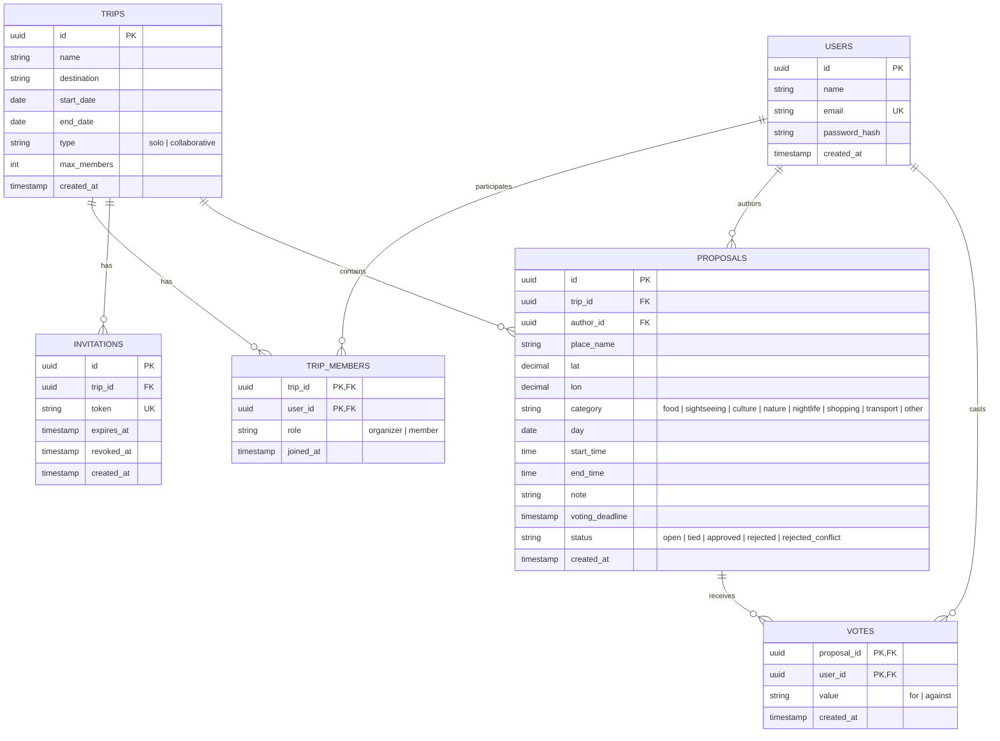

# MapMates: Data Model

## 1. Entity-relationship diagram

## 2. Tables

### users
| Column | Type | Constraints |
| --- | --- | --- |
| id | uuid | PK, default `gen_random_uuid()` |
| name | text | NOT NULL |
| email | text | NOT NULL, UNIQUE (stored lowercase) |
| password_hash | text | NOT NULL (never the plain password) |
| created_at | timestamptz | NOT NULL, default `now()` |

### trips
| Column | Type | Constraints |
| --- | --- | --- |
| id | uuid | PK |
| name | text | NOT NULL |
| destination | text | NOT NULL |
| start_date | date | NOT NULL |
| end_date | date | NOT NULL, CHECK `end_date >= start_date` |
| type | text | NOT NULL, CHECK in (`solo`, `collaborative`); immutable (BR-13) |
| max_members | int | NOT NULL, default 15, CHECK `> 0` (BR-08) |
| created_at | timestamptz | NOT NULL, default `now()` |

### trip_members
| Column | Type | Constraints |
| --- | --- | --- |
| trip_id | uuid | PK (part 1), FK to trips, ON DELETE CASCADE |
| user_id | uuid | PK (part 2), FK to users, ON DELETE CASCADE |
| role | text | NOT NULL, CHECK in (`organizer`, `member`) |
| joined_at | timestamptz | NOT NULL, default `now()` |

Exactly one organizer per trip: partial unique index on `(trip_id)` where `role = 'organizer'` (BR-01).

### invitations
| Column | Type | Constraints |
| --- | --- | --- |
| id | uuid | PK |
| trip_id | uuid | NOT NULL, FK to trips, ON DELETE CASCADE |
| token | text | NOT NULL, UNIQUE, random and unguessable (BR-07) |
| expires_at | timestamptz | NOT NULL |
| revoked_at | timestamptz | NULL while the link is active |
| created_at | timestamptz | NOT NULL, default `now()` |

### proposals
| Column | Type | Constraints |
| --- | --- | --- |
| id | uuid | PK |
| trip_id | uuid | NOT NULL, FK to trips, ON DELETE CASCADE |
| author_id | uuid | NOT NULL, FK to users |
| place_name | text | NOT NULL |
| lat | numeric(9,6) | NOT NULL, CHECK between -90 and 90 |
| lon | numeric(9,6) | NOT NULL, CHECK between -180 and 180 |
| category | text | NOT NULL, CHECK in (`food`, `sightseeing`, `culture`, `nature`, `nightlife`, `shopping`, `transport`, `other`) |
| day | date | NOT NULL (must fall within the trip dates, BR-06) |
| start_time | time | NOT NULL |
| end_time | time | NOT NULL, CHECK `end_time > start_time` (BR-09) |
| note | text | NULL, CHECK `char_length(note) <= 280` (BR-14) |
| voting_deadline | timestamptz | NOT NULL (between 1 hour and 3 days after creation, BR-15) |
| status | text | NOT NULL, CHECK in (`open`, `tied`, `approved`, `rejected`, `rejected_conflict`) |
| created_at | timestamptz | NOT NULL, default `now()` |

### votes
| Column | Type | Constraints |
| --- | --- | --- |
| proposal_id | uuid | PK (part 1), FK to proposals, ON DELETE CASCADE |
| user_id | uuid | PK (part 2), FK to users, ON DELETE CASCADE |
| value | text | NOT NULL, CHECK in (`for`, `against`) |
| created_at | timestamptz | NOT NULL, default `now()` |

The composite primary key guarantees at most one vote per user per proposal (BR-02).

## 3. Where business rules are enforced
Rules are defined in `docs/01-requirements.md`; this table only shows how each one is enforced by the data model or the application.

| Rule | Enforced by |
| --- | --- |
| BR-01 One organizer per trip | Partial unique index on `trip_members(trip_id)` where `role = 'organizer'` |
| BR-02 One vote per user per proposal | Composite primary key `(proposal_id, user_id)` on `votes` |
| BR-07 Invitation links are unguessable, expirable and revocable | `invitations.token` (UNIQUE, random), `expires_at`, `revoked_at` |
| BR-08 Maximum members per trip | `trips.max_members`; the member count is checked by the application when joining |
| BR-09 Valid time interval | `CHECK (end_time > start_time)` on `proposals` |
| BR-13 Trip type is immutable | `CHECK` on allowed values; immutability is enforced by the application (no update path for `type`) |
| BR-14 Note of at most 280 characters | `CHECK (char_length(note) <= 280)` on `proposals` |
| BR-15 Voting between 1 hour and 3 days | Validated by the application at creation; `voting_deadline` stores the result |
| BR-10, BR-11 No overlap between approved activities | Validated by the application (UC-08 step 5, UC-15 step 4) |