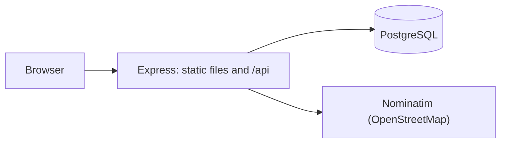
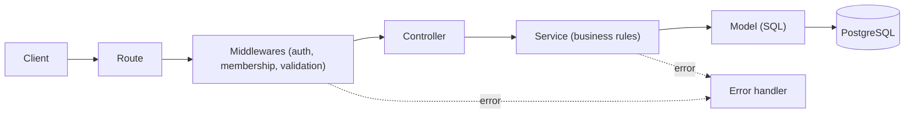

# MapMates: Architecture

## 1. Overview

MapMates is a single-origin web application. Express serves the static frontend (HTML, CSS, JavaScript and Leaflet) and a JSON REST API under `/api`. The API stores data in PostgreSQL. The external geocoding service (Nominatim) is called only from the backend.



## 2. Technology

| Area | Choice |
| --- | --- |
| Frontend | HTML, CSS, JavaScript, Leaflet.js |
| Backend | Node.js with Express |
| Database | PostgreSQL (`pg` driver, parameterized queries) |
| Authentication | `express-session` with sessions stored in PostgreSQL, httpOnly cookie |
| Passwords | bcrypt (cost factor 12) |
| Validation | Zod schemas |
| HTTP hardening | `helmet`, `express-rate-limit` |
| Tests | Jest and Supertest (integration), Playwright (E2E) |
| CI/CD | GitHub Actions (from Sprint 3) |

The stack is preliminary and can be adjusted during development.

## 3. Project structure

```
mapmates/
|-- docs/                  project documentation
|-- db/
|   |-- migrations/        SQL files that create and change the schema
|-- public/                frontend served as static files
|   |-- css/               tokens.css (colors, type scale), layout and components
|   |-- js/                api.js (fetch wrapper), pages and map modules
|   |-- index.html, login.html, trips.html, trip.html
|-- src/
|   |-- server.js          starts the HTTP server
|   |-- app.js             builds the Express app (no listen), used by tests
|   |-- config/            environment variables and database pool
|   |-- routes/            one file per resource
|   |-- middlewares/       auth, membership, validation, errors, rate limits
|   |-- controllers/       HTTP layer
|   |-- services/          business rules
|   |-- models/            SQL queries
|   |-- validators/        Zod schemas
|   |-- utils/             AppError, token generator, ics builder
|-- tests/
|   |-- integration/
|   |-- e2e/
|-- .env.example
|-- .gitignore
|-- package.json
|-- README.md
```

`app.js` is separate from `server.js` so integration tests can load the app without opening a port.

## 4. Layers and responsibilities

| Layer | Responsibility | Must not |
| --- | --- | --- |
| Routes | Map an HTTP method and path to a chain of middlewares and a controller | Contain logic |
| Middlewares | Authentication, trip membership and role checks, input validation, rate limiting, error handling | Access the database for business decisions |
| Controllers | Read the request, call a service, build the HTTP response and status code | Contain SQL or business rules |
| Services | Business rules: overlap check, voting window, status transitions, member limit | Know about `req` or `res` |
| Models | SQL queries with parameters; one module per table | Contain business rules |
| Validators | Describe the valid shape of each request | Perform authorization |

## 5. Request flow



Example, voting on a proposal (`PUT /api/trips/:tripId/proposals/:proposalId/vote`):

1. The route runs `requireAuth` (401 if there is no session).
2. `requireTripMember` checks the user belongs to the trip (403 otherwise).
3. `validate(voteSchema)` checks the UUIDs and that `value` is `for` or `against` (400 otherwise).
4. The controller calls `voteService.castVote`.
5. The service verifies the proposal is `open` and its deadline has not passed (409 otherwise), then applies the vote, replacement or withdrawal (BR-02, BR-03).
6. The model runs the parameterized query and the controller answers 200.

## 6. API overview

| Method and path | Use case |
| --- | --- |
| `POST /api/auth/register` | UC-01 |
| `POST /api/auth/login` | UC-02 |
| `POST /api/auth/logout` | UC-03 |
| `POST /api/trips` | UC-04 |
| `GET /api/trips` | UC-05 |
| `GET /api/trips/:tripId` | UC-10, UC-11 (trip data) |
| `PATCH /api/trips/:tripId` | UC-13 |
| `DELETE /api/trips/:tripId` | UC-13 |
| `POST /api/trips/:tripId/invitation` | UC-14 (generate or regenerate) |
| `DELETE /api/trips/:tripId/invitation` | UC-14 (revoke) |
| `POST /api/invitations/:token/join` | UC-06 |
| `DELETE /api/trips/:tripId/members/me` | UC-07 |
| `GET /api/places/search?q=` | UC-08 (place search) |
| `POST /api/trips/:tripId/proposals` | UC-08 |
| `GET /api/trips/:tripId/proposals` | UC-10 |
| `DELETE /api/trips/:tripId/proposals/:proposalId` | UC-16 |
| `PUT /api/trips/:tripId/proposals/:proposalId/vote` | UC-09 |
| `POST /api/trips/:tripId/proposals/:proposalId/close` | UC-15 (early close) |
| `POST /api/trips/:tripId/proposals/:proposalId/resolve` | UC-15 (tie decision) |
| `GET /api/trips/:tripId/itinerary` | UC-11 |
| `GET /api/trips/:tripId/itinerary.ics` | UC-12 |

## 7. Middlewares

| Middleware | Purpose |
| --- | --- |
| `requireAuth` | Rejects requests without a valid session (401) |
| `requireTripMember` | Loads the membership of the user in the trip (403, or 404 if the trip does not exist) |
| `requireOrganizer` | Requires the role `organizer` in the trip (403) |
| `validate(schema)` | Validates params, query and body with Zod (400) |
| `rateLimit` | Limits login, registration and place search (429) |
| `notFound` | Unknown routes (404) |
| `errorHandler` | Converts errors to a JSON response and hides internal details |

## 8. Error handling

Services and middlewares throw an `AppError` with a status code and a code. The `errorHandler` answers with:

```json
{ "error": { "code": "VOTING_CLOSED", "message": "Voting is closed for this proposal" } }
```

Unexpected errors answer 500 with a generic message. Stack traces and SQL errors are logged on the server and never sent to the client.

## 9. Frontend

Static pages served by Express. `public/js/api.js` wraps `fetch` and handles 401 by redirecting to the login page. Leaflet draws the itinerary map. Colors, type scale and spacing live in CSS variables (`tokens.css`): dark tones with a single accent color, large type and a responsive layout for desktop, tablet and mobile.

## 10. Testing and CI/CD (planned)

- Integration tests (Jest and Supertest) run against a separate test database and cover success paths, invalid input and access restrictions for each endpoint.
- E2E tests (Playwright) cover the main flows from Sprint 3.
- Coverage target: at least 90% at final delivery.
- GitHub Actions runs the tests on every pull request and deploys from `main` (from Sprint 3).